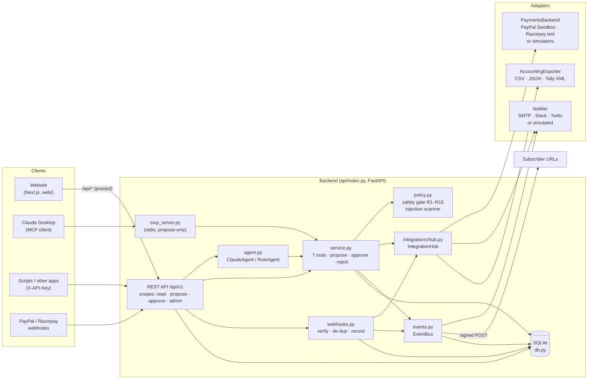
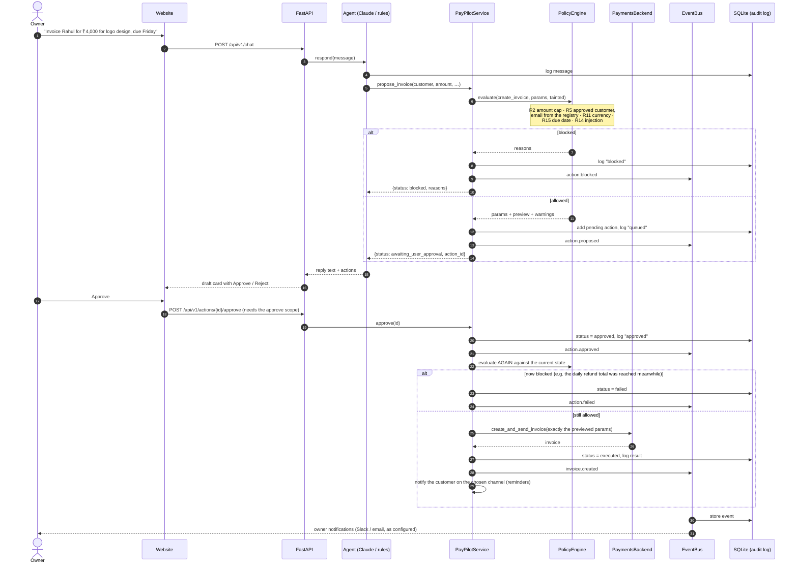
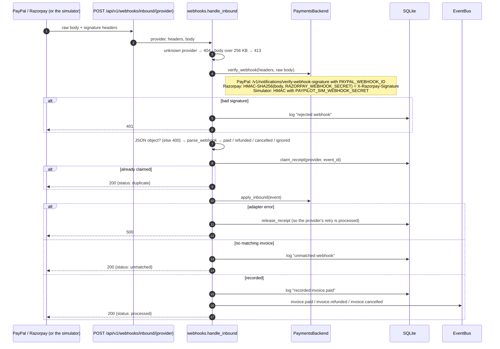
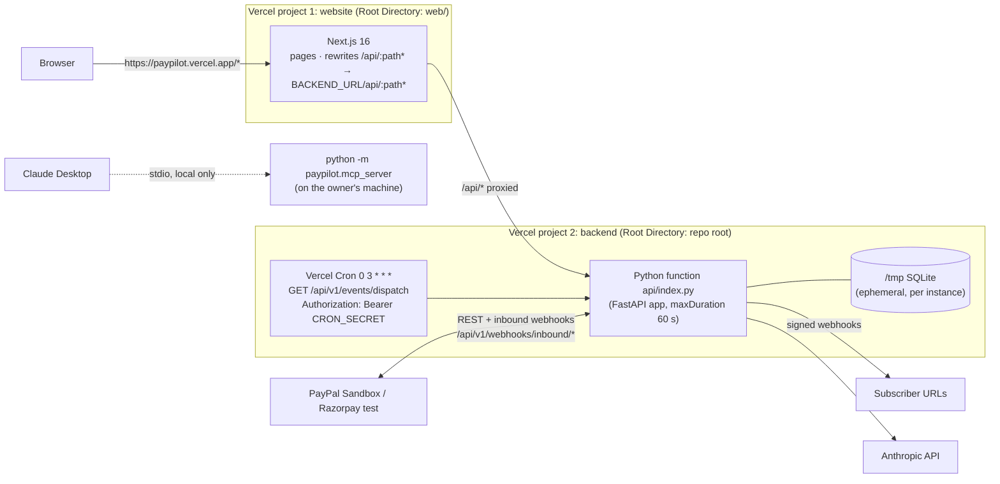

# PayPilot: Architecture

This document describes PayPilot 3.0.0 as it is built. For the rule list, see [REQUIREMENTS.md](REQUIREMENTS.md).
For the tool schemas, the action lifecycle and the normalized invoice, see [DESIGN.md](DESIGN.md).

## 1. System overview

The core is plain Python and imports no vendor SDK at module level (a test checks this). Everything
vendor-specific sits behind three interfaces, `PaymentsBackend`, `Notifier` and `AccountingExporter`, and
`IntegrationHub` picks a real or simulated adapter for each one from the settings.



`app_context.build_context(settings, db)` connects everything in this order: `Database` → `IntegrationHub`
(payments, notifiers, exporters, a lazy `EventBus`) → `PayPilotService` → agent. The API builds a context
for each request, on a cached `Database` for that request's workspace. The MCP server builds one context for
its whole process.

| Module | Responsibility |
|---|---|
| `config.py` | `Settings.from_env()`: every environment variable, and the demo-mode and open-access switches |
| `db.py` | SQLite tables: customers, pending_actions, audit_log, settings, mock_invoices, notifications, events, webhook_subscriptions, webhook_deliveries, webhook_receipts, api_keys |
| `parsing.py` | Amounts (`₹1,00,000`, `4k`, `$300`, `Rs 2,500`) and due dates (`Friday`, `30 Dec`, ISO) |
| `backends.py` | `PaymentsBackend`, the PayPal sandbox adapter, `MockBackend` (the simulator for both providers), `make_backend` |
| `policy.py` | `PolicyEngine.evaluate()` (rules R1–R15) and `scan_for_injection()` |
| `service.py` | The 7 agent tools (4 read, 3 propose), `propose`, `approve` (which re-checks the gate), `reject` |
| `agent.py` | `ClaudeAgent` (Anthropic tool calling) and `RuleAgent` (offline), both limited to the 7 tools |
| `events.py` | `EventBus`: stores events, notifies the owner, sends signed outbound webhooks with an SSRF guard |
| `webhooks.py` | `handle_inbound`: size limit, signature check, parse, idempotent claim, apply, emit |
| `auth.py` | Hashed, scoped API keys, the owner password check, the HMAC session cookie |
| `mcp_server.py` | FastMCP server with the 7 tools; no approve tool; a 10-minute taint window |

## 2. Propose → approve

The model, the REST API and MCP all reach `service.propose()`, which can only add a row to the inbox. Only
`service.approve()` calls the payment provider, and the API only lets that happen for a principal with the
`approve` scope. That means the owner (logged in, or using open access in demo mode) or an API key explicitly
given `approve` or `admin`.



Notes:

- **Exactly what was previewed is executed.** The stored params are the gate's normalized output. For
  invoices, the customer is looked up again in the registry at approval, so a changed or unapproved customer
  is caught.
- **An approved action is never its own duplicate.** Its status changes to `approved` before the re-check, so
  R9 ("already pending") does not count it.
- **Tainted turns.** When a read tool returns text that the scanner flags, the rest of the agent turn is
  tainted, and `propose_refund` is blocked. On MCP the taint lasts 10 minutes, because MCP has no turn boundary.

## 3. Inbound webhooks

Inbound webhooks record facts. They never create actions, run actions or call the model.



Provider event mapping:

| Provider | Provider event | PayPilot fact |
|---|---|---|
| PayPal | `INVOICING.INVOICE.PAID` | `invoice.paid` |
| PayPal | `INVOICING.INVOICE.REFUNDED`, `PAYMENT.CAPTURE.REFUNDED` | `invoice.refunded` |
| PayPal | `INVOICING.INVOICE.CANCELLED` | `invoice.cancelled` |
| Razorpay | `invoice.paid`, `invoice.partially_paid` | `invoice.paid` |
| Razorpay | `refund.processed` | `invoice.refunded` |
| Razorpay | `invoice.cancelled`, `invoice.expired` | `invoice.cancelled` |

Anything else is logged as `ignored`. In demo mode, `POST /api/v1/simulate/payment/{ref}` (the website's
"Customer pays" button) asks the simulator to build and sign a real-format webhook. That webhook then goes
through the same `handle_inbound` path.

## 4. Vercel topology

One repository holds two Vercel projects. The browser only talks to the website, and the website forwards
`/api/*` to the backend, so the backend's cookies (`pp_sid` for the demo workspace, `pp_owner` for the login)
are first-party.



The backend's `vercel.json`:
- runs `api/index.py` as a function with `maxDuration: 60`;
- sends `/` and `/api/(.*)` to `/api/index`; FastAPI still sees the original path;
- schedules the daily retry cron.

`.vercelignore` keeps tests, docs, scripts, data, `web/`, `.env` and dev requirements out of the function.
With only `requirements.txt` installed, the function needs 28 packages, about 62 MB of site-packages (49 MB
without pip). It does not need `mcp`, `uvicorn` or `playwright`.

Storage on Vercel: the deployment filesystem is read-only, so with `VERCEL` set and no `PAYPILOT_DB`, the
database goes to the temp directory. Demo workspaces live there too. That storage is per-instance and
ephemeral (see Limitations in the [README](../README.md)).

## 5. Adapter interfaces

### PaymentsBackend (`paypilot/backends.py`)

```python
class PaymentsBackend(ABC):
    name: str; provider: str; simulated: bool
    def status(self) -> dict                         # {provider, name, simulated, mode, label}; never secrets
    # outbound: called only by service.approve() (and read tools)
    def create_and_send_invoice(self, customer_name, customer_email, amount, currency,
                                description, due_date, note="") -> dict   # normalized invoice
    def list_invoices(self) -> list[dict]
    def get_invoice(self, invoice_id) -> dict
    def send_reminder(self, invoice_id, note) -> dict
    def refund(self, invoice_id, amount, reason) -> dict   # always to the original payment (R8)
    def record_payment(self, invoice_id, amount=None) -> dict
    # inbound
    def verify_webhook(self, headers, body: bytes) -> None    # raise WebhookVerificationError
    def parse_webhook(self, payload: dict) -> InboundEvent    # paid / refunded / cancelled / ignored
    def apply_inbound(self, event) -> dict | None             # default: re-read the invoice
```

Every adapter returns the **normalized invoice** from DESIGN.md §4: `id`, `number`, `customer_name`,
`customer_email`, `amount`, `currency`, `description`, `note`, `due_date`, `status`, `paid_amount`,
`refunded_amount`, `provider`, and so on. Amounts are rounded with Decimal to 2 places. Vendor errors are
re-raised as `BackendError` with credential-free messages, and the API turns them into 502 responses.

### Notifier (`paypilot/integrations/base.py`)

```python
class Notifier(ABC):
    channel: str   # email | whatsapp | slack
    adapter: str   # smtp | slack-webhook | twilio | simulator
    simulated: bool
    def send(self, to, subject, body) -> dict   # records every attempt; raises NotificationError on failure
    def _deliver(self, to, subject, body) -> dict | None   # the only method an adapter implements
```

`send()` scrubs every known credential out of error text before it records or raises anything.

### AccountingExporter

```python
class AccountingExporter(ABC):
    format: str; mime: str; extension: str; label: str
    def export(self, invoices: list[dict], business_name: str) -> str
```

The CSV exporter neutralises spreadsheet formulas: cells starting with `=`, `+`, `-`, `@`, a tab or a carriage return are prefixed with
`'`.

### How to add Stripe

1. **Write the adapter.** Create `paypilot/integrations/stripe.py` with `class StripeBackend(PaymentsBackend)`,
   with `provider = "stripe"` and `simulated = False`.
   - Import `stripe`, or use `requests`, **inside** the module, never from the core.
   - Map Stripe Invoices to the normalized invoice. Amounts are in the smallest currency unit, like Razorpay's
     paise, so reuse the `to_paise`/`from_paise` pattern.
   - `refund()` refunds the invoice's own PaymentIntent. Never accept a destination.
   - `verify_webhook()` checks `Stripe-Signature` (`t=…,v1=HMAC-SHA256(secret, "t.body")`) with a tolerance.
     `parse_webhook()` maps `invoice.paid` → `invoice.paid`, `charge.refunded` → `invoice.refunded` and
     `invoice.voided` → `invoice.cancelled`.
2. **Configuration.** Add `stripe_secret_key` and `stripe_webhook_secret` to `Settings` with `repr=False`, a
   `has_stripe_keys` property, `"stripe"` in `PAYMENT_PROVIDERS`, and the keys in `has_real_keys`.
3. **Selection.** Add a `"stripe"` branch to `make_backend()`: the real adapter when the keys are set and demo
   mode is off, otherwise `MockBackend(db, provider="stripe", …)`. The simulator needs a Stripe-shaped
   `simulate_webhook`, and `PROVIDER_LABELS["stripe"] = "Stripe"`.
4. **Inbound.** `handle_inbound` accepts any provider in `PROVIDER_LABELS`, so
   `POST /api/v1/webhooks/inbound/stripe` works with no route change. If Stripe's event-id header should be
   used for de-duplication, add it to `EVENT_ID_HEADERS`.
5. **Website.** Add `"stripe"` to the `Provider` type in `web/src/lib/api.ts` and a card on the Integrations page.
6. **Tests.**
   - Copy the Razorpay ones in `test_integrations.py` and `test_webhooks.py`: a fake HTTP session, paise
     conversion, signature accept and reject, idempotency, and no credentials in errors.
   - Add the module to the "core imports no vendor SDK" check.

The safety gate, service, agent, events and API need **no changes**. They only see `PaymentsBackend`.

## 6. Event catalog

Every event is stored as `{id: "evt_…", type, created, data}`. It is shown under **Activity**, sent to the owner
when `policy.owner_notifications[type]` lists `slack` and/or `email`, and delivered to every subscription for
that type. Event data never contains credentials or customer addresses.

| Type | Emitted by | `data` |
|---|---|---|
| `action.proposed` | `service.propose` (allowed) | `action_id`, `action`, `preview`, `warnings`, `source` (`chat`, `ui`, `mcp`, `api:<key name>`) |
| `action.blocked` | `service.propose` (gate refused) | `action`, `reasons`, `source` |
| `action.approved` | `service.approve` | `action_id`, `action`, `by` |
| `action.rejected` | `service.reject` | `action_id`, `action`, `by` |
| `action.failed` | `service.approve` (re-check failed or provider error) | `action_id`, `action`, `reasons` or `error` |
| `invoice.created` | approved `create_invoice` executed | `action_id`, `invoice` {`id`, `number`, `customer_name`, `amount`, `currency`, `due_date`, `status`, `provider`} |
| `reminder.sent` | approved `send_reminder` executed | `action_id`, `invoice_id`, `number`, `channel` |
| `refund.completed` | approved `refund` executed | `action_id`, `invoice_id`, `number`, `amount`, `currency`, `refund_id` |
| `invoice.paid` | inbound webhook | `provider`, `invoice_id`, `number`, `customer`, `currency`, `amount`, `status`, `provider_event_id` |
| `invoice.refunded` | inbound webhook | same as `invoice.paid` |
| `invoice.cancelled` | inbound webhook | same as `invoice.paid` |

Outbound delivery:

- **Request.** `POST <url>` with body `{"id","type","created","data"}` and these headers: `Content-Type:
  application/json`, `User-Agent: PayPilot-Webhooks/1.0`, `PayPilot-Event`, `PayPilot-Delivery: dlv_…` and
  `PayPilot-Signature: t=<unix>,v1=<hex HMAC-SHA256(secret, "<t>.<body>")>`.
- **Verifying it.** Receivers check the signature with `paypilot.events.verify_signature`, which allows 300
  seconds of clock tolerance.
- **Delivery rules.**
  - Timeout of 5 seconds, and redirects are never followed.
  - Only 2xx counts as success.
  - The SSRF guard is applied when you subscribe and again at delivery, with a fresh DNS lookup (against DNS
    rebinding). It requires https and rejects private, loopback, link-local and reserved IPs, `localhost`,
    `*.local` and `*.internal`.
  - In demo mode, deliveries are recorded as successful and nothing is sent.
- **Retries.** `GET|POST /api/v1/events/dispatch` retries failed deliveries, up to 5 attempts in total.

## 7. REST API

All routes are under `/api/v1`. Interactive docs are at `/api/docs`, and the schema is at `/api/openapi.json`.

**Who gets which scopes:**

- **API key** (`X-API-Key: pp_<8 hex>_<secret>`): that key's scopes. The default is `read` + `propose`, and
  `admin` implies every scope. An invalid or revoked key gets a 401.
- **No key, with open access or a valid `pp_owner` cookie:** every scope. Open access is the default in demo
  mode.
- **Otherwise:** only the "none" routes in the table.

| Method | Path | Scope | Purpose |
|---|---|---|---|
| GET | `/health` | none | Version, demo mode, agent, payments adapter status, business name, currency |
| GET | `/session` | none | Whether the caller is authenticated, their scopes, whether login is available, open access |
| POST | `/login` · `/logout` | none | Owner password → `pp_owner` cookie (HttpOnly, SameSite=Lax, 12 h) |
| GET | `/integrations` | read | Status of every adapter (never secrets) |
| POST | `/chat` | propose | Talk to the agent → `{text, table, tainted, actions}` |
| GET | `/actions?status=` | read | The Approval inbox and its history |
| POST | `/actions` | propose | Propose directly: `{tool: propose_invoice\|propose_reminder\|propose_refund, args}` → 201, or 422 with `reasons` when blocked |
| POST | `/actions/{id}/approve` · `/reject` | approve | Decide. 404 if missing, 409 if not pending |
| GET | `/invoices` | read | Invoices with `outstanding` and `security_flags`, unpaid rows, totals |
| GET | `/customers` | read | The customer list |
| POST | `/customers` | admin | Add or update a customer (email checked; phone must be E.164) |
| GET | `/policy` | read | Safety rule limits and owner notification routing |
| PUT | `/policy` | admin | Change the limits (logged with the old and new values) |
| POST | `/policy/reset` | admin | Restore the defaults |
| GET | `/audit?limit=` | read | The audit log |
| GET | `/events?type=&limit=` | read | The event log |
| GET, POST | `/events/dispatch` | `Bearer CRON_SECRET` or admin | Retry failed webhook deliveries |
| GET | `/notifications` | read | Every email, Slack or WhatsApp message sent or simulated |
| GET | `/exports/{csv\|json\|tally}` | read | Accounting export (file download) |
| GET | `/webhooks/subscriptions` | read | Subscriptions (secret masked) with their recent deliveries |
| POST | `/webhooks/subscriptions` | admin | Subscribe `{url, events, description}`. The signing secret is shown once |
| DELETE | `/webhooks/subscriptions/{id}` | admin | Unsubscribe |
| POST | `/webhooks/inbound/{paypal\|razorpay}` | signature | Provider webhooks (section 3) |
| POST | `/simulate/payment/{ref}` | approve | Simulator only: a signed "paid" webhook for that invoice |
| GET | `/keys` | admin | API keys (prefix, name, scopes; never the key) |
| POST | `/keys` | admin | Create `{name, scopes}`. The full key is shown once and stored as SHA-256 |
| DELETE | `/keys/{id}` | admin | Revoke |
| POST | `/demo/reset` | none (demo mode only) | Delete this visitor's workspace |

`GET /` returns a JSON index. When `PAYPILOT_FRONTEND_URL` is https, it redirects there with a 307.

## 8. Security model

| Threat | Control |
|---|---|
| The model sends money or messages on its own | It only has 4 read tools and 3 propose tools. Unknown tool names are refused and logged. Execution exists only in `service.approve`, behind the `approve` scope |
| Prompt injection in invoice notes or descriptions | Third-party text is wrapped as `{"untrusted_text": …}`, and the system prompt says it is data. `scan_for_injection` flags instruction-like text: refunds are blocked for the tainted turn (10 minutes on MCP), and injected text inside a proposal field blocks it |
| The model or a user redirects an invoice | R5: the email and phone always come from the registry. A supplied address is ignored, with a warning. Refunds have no destination field (R8) |
| The state changes between proposal and approval | The gate runs again at approval against the current state (daily refund total, refundable balance, one reminder a day, customer still approved) |
| A leaked API key | Keys are stored as SHA-256 hashes, are scoped (default read + propose, so no approve), are revocable, and their proposals are tagged `api:<name>` |
| A stolen session | The `pp_owner` cookie is an HMAC-signed expiry (12 h), HttpOnly, SameSite=Lax and Secure over https. The password check is constant-time |
| Forged webhooks or replays | Signature verification on the raw body per provider, an idempotent `webhook_receipts` claim, a 256 KB limit, and facts only |
| SSRF through webhook subscriptions | https only, public IPs only, checked again with DNS at delivery, no redirects |
| Credential leaks | Secrets are `repr=False`, live only inside adapters, are scrubbed from notifier and adapter errors, and are never in `status()`, events, logs or API responses. Tests look for them in every output |
| One demo visitor seeing another's data | Each visitor gets a separate SQLite file, keyed by a random UUID in the `pp_sid` cookie |
| A CSV export becoming a spreadsheet exploit | Formula prefixes are neutralised |
| Browser-side attacks | `nosniff`, `X-Frame-Options: DENY`, `Referrer-Policy` and `Cache-Control: no-store` on the API. The chat's markdown renderer only builds React elements and never injects HTML |

**What is not covered yet:** no rate limiting on `/login` or `/chat`; CORS is limited to `PAYPILOT_FRONTEND_URL`,
but there is no CSRF token, and the defence relies on SameSite=Lax plus JSON bodies; a single owner per
deployment.

## 9. Configuration

Every variable is listed in [.env.example](../.env.example), with where to get it. The ones that decide how
PayPilot behaves:

| Setting | Effect |
|---|---|
| No PayPal, Razorpay or Claude key, or `PAYPILOT_DEMO_MODE=true` | **Demo mode.** Simulators, the rule agent, simulated notifiers, webhooks recorded but not sent, a private workspace per visitor, open access, a Reset button |
| Keys set and `PAYPILOT_DEMO_MODE` unset or `false` | **Live sandbox.** Each adapter with keys is real. One database (`PAYPILOT_DB`). Login required unless `PAYPILOT_OPEN_ACCESS=true` |
| `ANTHROPIC_API_KEY` (demo off) | `ClaudeAgent` with `PAYPILOT_MODEL` (default `claude-sonnet-5-5`); otherwise `RuleAgent` |
| `PAYPILOT_PAYMENT_PROVIDER` | `paypal` (default) or `razorpay`, for new invoices. Inbound webhooks work for both |
| `PAYPILOT_DB` | SQLite path when demo mode is off. Default `data/paypilot.db`, or the temp dir when `VERCEL` is set |
| `PAYPILOT_DB_DIR` | Folder for demo workspaces (default: the temp dir) |
| `DATABASE_URL` | Reserved for Postgres. **Not implemented** |

The website needs only `BACKEND_URL` (default `http://127.0.0.1:8000`).

## 10. Verification

| Check | Command | Result for 3.0.0 |
|---|---|---|
| Unit, functional, safety, API and MCP tests | `pytest -q` | 273 passed |
| Website types, lint and production build | `cd web && npm run lint && npm run build` | clean |
| Browser run (light, dark, mobile) | `python scripts/next_demo.py` with both servers running | 28 screenshots, no JS errors, no sideways scrolling on mobile |
| The Vercel function imports with production dependencies only | in a fresh venv: `pip install -r requirements.txt`, then `python -c "import api.index"` | imports; `mcp`, `uvicorn`, `playwright` are absent; 62 MB |
| PayPal layer | `python scripts/sandbox_smoke.py` | lists sandbox invoices with keys, simulator invoices without |
| Safety gate, in a terminal | `python scripts/safety_demo.py` | ₹90,000 blocked; ₹4,000 queued, then executed on approve; tainted-turn refund blocked |

Rule-by-rule tests (R1–R15) are in `tests/test_safety.py`. [test_results.txt](test_results.txt) holds the
latest full run.
